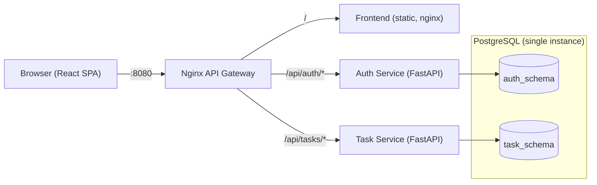

# Architecture

- **Gateway**: the only published port. Strips the `/api/auth` and `/api/tasks` prefixes before proxying.
- **Auth Service**: owns `auth_schema.users`; hashes passwords with bcrypt and issues HS256 JWTs.
- **Task Service**: owns `task_schema.projects` and `task_schema.tasks`; verifies JWTs with the shared secret and scopes all data to the token's user id (stored as `owner_id`, no cross-schema foreign key).
- Each service has its own Dockerfile and creates its own schema and tables at startup.
